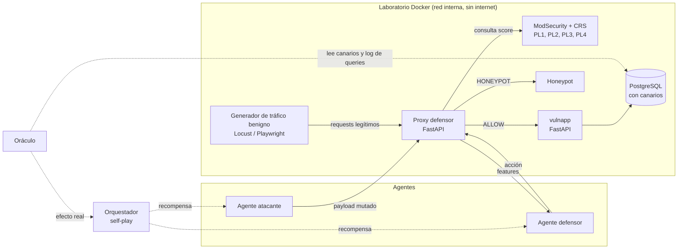

# Arquitectura

## Componentes

| Componente | Responsabilidad | Contrato | Construye |
|---|---|---|---|
| `vulnapp` | App con 8 endpoints vulnerables catalogados y flujos benignos (navegación, login, carrito, búsqueda, comentarios). | `lab/vulnapp/ENDPOINTS.md` (F1-T02) | Diego |
| PostgreSQL | Datos de la app, tabla de canarios, log de queries. | [oráculo](../02-contratos/oraculo.md) | Diego |
| ModSecurity PL1–PL4 | Cuatro instancias Nginx + CRS, una por paranoia level. Señal para el defensor y línea base. | [features](../02-contratos/features.md) | Diego |
| Proxy defensor | Recibe cada request, extrae features, consulta ModSecurity, pide acción a una `DefenderPolicy` y la aplica. | [env-defensor](../02-contratos/env-defensor.md) | Diego |
| Oráculo | Decide si un payload es funcional y si tuvo efecto. | [oráculo](../02-contratos/oraculo.md) | Diego |
| Operadores de mutación | Transformaciones del payload. Espacio de acciones del atacante. | [operadores](../02-contratos/operadores-mutacion.md) | Diego |
| Entornos Gymnasium | `WafArena/Attacker-v0` y `WafArena/Defender-v0`. | [env-atacante](../02-contratos/env-atacante.md), [env-defensor](../02-contratos/env-defensor.md) | Diego |
| Runner y evaluación | Ejecución de experimentos desde YAML, métricas, harness de evaluación. | [experimentos](../02-contratos/experimentos.md), [métricas](../02-contratos/metricas.md) | Daniel |
| Agentes | Bandits, tabulares, lineal, DQN, policy gradient, Dyna. | [agentes](../02-contratos/agentes-y-checkpoints.md) | Daniel, Joaquín, Nelson |
| Orquestador self-play | Alterna entrenamiento, mantiene pool de oponentes, evalúa contra referencias fijas. | [agentes](../02-contratos/agentes-y-checkpoints.md) | Nelson |
| Dashboard | Tráfico en vivo, decisiones del defensor, matriz de cruces. | — | Nelson |

## Flujo de un request en modo real

1. Un cliente (atacante o generador benigno) envía un request HTTP al proxy con un header `X-Session-ID`.
2. El proxy asigna `X-Request-ID`, reenvía una copia a la instancia de ModSecurity del PL configurado y obtiene el anomaly score y si ModSecurity lo habría bloqueado.
3. El proxy calcula las features del request y actualiza las features de la sesión.
4. El proxy llama a `DefenderPolicy.act(obs)` y aplica la acción: reenviar a `vulnapp`, responder 403, responder un captcha simulado, responder 429 o reenviar al honeypot.
5. Si el request llegó a `vulnapp`, el oráculo consulta canarios y log de queries para ese `X-Request-ID`.
6. El orquestador (o el entorno Gymnasium) calcula la recompensa de cada agente con la decisión y la respuesta del oráculo.

## Entorno de dos velocidades

RL necesita cientos de miles de pasos. Pasar cada paso por HTTP y Docker no alcanza. Ver [ADR-0005](../06-decisiones/adr-0005-dos-velocidades.md).

| | Modo rápido (`backend: fast`) | Modo real (`backend: real`) |
|---|---|---|
| Uso | Entrenamiento | Validación y demo |
| `vulnapp` | Funciones de consulta importadas en proceso, contra el PostgreSQL del laboratorio | HTTP |
| ModSecurity | HTTP en lote a las instancias PL1–PL4 con caché persistente `(PL, hash del request) → (score, bloqueado)` | HTTP por request |
| Oráculo | Llamado como función | Llamado como función tras el request HTTP |
| Tráfico benigno | Sesiones pregrabadas en `data/benign/` | Sesiones pregrabadas o generadas en vivo |
| Meta de rendimiento | ≥ 300 pasos/s del entorno atacante con caché caliente | Lo que dé; se mide y se reporta |

La tarea F1-T11 incluye una prueba de concordancia: con las mismas semillas, ambos modos deben coincidir en al menos 99 % de las decisiones de 1 000 requests muestreados. El experimento EXP-R1 (Fase 4) reporta la brecha final en métricas.

## Observabilidad parcial

El atacante no ve el estado interno del defensor, solo sus respuestas. El problema del atacante es un POMDP. El entorno lo aproxima incluyendo en la observación una ventana de las últimas `k = 4` respuestas. El informe debe declararlo así.
