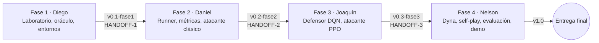
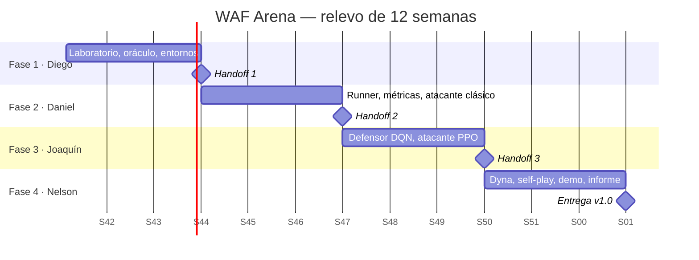

# Plan maestro

## Modelo de trabajo: relevo secuencial

El equipo trabaja en relevo. Cada fase tiene un solo dueño, recibe una sola vez el entregable de la fase anterior y entrega una sola vez a la siguiente ([ADR-0002](../06-decisiones/adr-0002-relevo-secuencial.md)).

**Qué cuenta como dependencia.** Recibir el tag y el handoff de la fase anterior. Esa es la única dependencia de cada persona. Después de aceptar el handoff, el dueño de la fase activa es dueño de todo el repositorio y no necesita consultar a quien entregó: todo lo necesario está en el handoff, en los contratos y en el código.

**Ventana de aceptación.** Quien recibe tiene 1 día hábil para correr el checklist de aceptación del handoff. Si algo falla, quien entregó lo corrige dentro de esa ventana. Eso forma parte de la misma dependencia, no es una segunda. Pasada la ventana, cualquier bug heredado lo corrige el dueño de la fase activa.

**Cada fase es acumulativa.** El tag de cada fase contiene todo lo anterior más lo nuevo, y cada handoff agrega su capítulo al informe. Al cerrar la Fase 4 el proyecto queda completo, sin una etapa extra de integración.

## Fases

| Fase | Dueño | Semanas | Objetivo | Entregable | RQ |
|---|---|---|---|---|---|
| 1 | Diego Valenzuela | 1–3 | Laboratorio aislado, oráculo verificado, corpus, tráfico benigno, operadores, features y los dos entornos Gymnasium en modo rápido y real | `v0.1-fase1` + [HANDOFF-1](../05-handoffs/handoff-1-diego-a-daniel.md) | — |
| 2 | Daniel Dubón | 4–6 | Runner de experimentos, métricas y suites de evaluación; atacante con bandits, DP, Monte Carlo y TD; referencia `ATK-REF-0` | `v0.2-fase2` + [HANDOFF-2](../05-handoffs/handoff-2-daniel-a-joaquin.md) | RQ1 |
| 3 | Joaquín Puente | 7–9 | Defensor lineal y DQN con variantes, frontera de Pareto contra ModSecurity; atacante REINFORCE, A2C y PPO; generalización del defensor estático; referencias `DEF-REF-1` y `ATK-REF-1` | `v0.3-fase3` + [HANDOFF-3](../05-handoffs/handoff-3-joaquin-a-nelson.md) | RQ2, RQ5 parcial |
| 4 | Nelson García | 10–12 | Atacante Dyna, self-play con pool, matriz de cruces, generalización final, validación en modo real, dashboard, informe integrado | `v1.0` | RQ3, RQ4, RQ5 |

Documentos detallados:
- [Fase 1 — Diego](fase-1-diego-laboratorio.md)
- [Fase 2 — Daniel](fase-2-daniel-atacante-clasico.md)
- [Fase 3 — Joaquín](fase-3-joaquin-deep-rl.md)
- [Fase 4 — Nelson](fase-4-nelson-planning-selfplay.md)

## Cronograma

Las fechas son de referencia. Ajustarlas al calendario real del curso en la primera reunión y actualizar este diagrama.

## Trabajo previo independiente

Mientras no es su turno, cada integrante puede adelantar trabajo que **no depende del entregable de nadie**, porque solo usa los contratos de este repositorio. Esto no rompe el relevo: el contrato ya existe desde el día 1.

| Persona | Puede adelantar sin depender de nadie |
|---|---|
| Daniel | Implementar bandits y algoritmos tabulares contra un entorno de juguete propio que respete la interfaz `Agent`; prototipar `metrics.py` y `stats.py` con datos sintéticos |
| Joaquín | Adaptar DQN y PPO estilo CleanRL a la interfaz `Agent` y probarlos en `CartPole-v1`; preparar los scripts de figuras de Pareto con datos sintéticos |
| Nelson | Implementar Dyna-Q, Dyna-Q+ y Prioritized Sweeping en un laberinto de juguete; esqueleto del dashboard Streamlit con datos falsos marcados como tales; plantilla de la matriz de cruces |
| Diego | (Fase activa desde el día 1) |

Todo código previo se integra en la rama de la fase cuando le toca a su dueño, y pasa por las mismas pruebas y revisión.

Recomendación para la defensa: que los cuatro estudien los métodos tabulares aunque solo Daniel los implemente en el proyecto, porque el jurado puede preguntarle a cualquiera.

## Reuniones mínimas

- **Kickoff (semana 1):** los cuatro leen `CLAUDE.md`, la visión y los contratos. Se ajusta el cronograma.
- **Relevo (fin de semanas 3, 6 y 9):** 30 minutos. Quien entrega muestra el checklist de aceptación corriendo y quien recibe confirma.
- **Cierre (semana 12):** ensayo de la presentación.

## Recortes de alcance

Si una fase se atrasa, recorta en este orden, sin pedir permiso a otras fases, y registra el recorte en *Hallazgos* de su documento y en el handoff:

1. Prioritized Sweeping (EXP-H3).
2. TD(λ) (EXP-D2) y triada mortal (EXP-E2).
3. Dueling DQN (EXP-F3): se conservan Double y PER.
4. A2C (EXP-G2): se conservan REINFORCE y PPO.
5. Dashboard en vivo: se reemplaza por un notebook con las figuras finales.

Nunca se recorta: el oráculo y sus pruebas, los splits congelados, la evaluación contra referencias fijas, ni la cantidad mínima de semillas.

## Definición de proyecto terminado

Ver [definicion-de-terminado.md](../04-metodologia-ai-first/definicion-de-terminado.md#proyecto).
