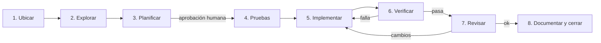

# Flujo de trabajo AI-first

## Principios

1. **La documentación es el contexto.** El agente no "recuerda" el proyecto entre sesiones: lo lee. Por eso todo lo que importa vive en `CLAUDE.md` y `docs/`, escrito para que un agente sin memoria previa pueda trabajar bien desde la primera sesión. Si algo se explicó en un chat y no quedó en los documentos, para el proyecto no existe.
2. **Especificación antes que código.** Cada tarea ya tiene en el documento de su fase qué hacer, qué archivos toca y cómo se acepta. El agente implementa contra esa especificación, no contra una conversación.
3. **Los contratos son la frontera.** Lo que cruza entre fases está en `docs/02-contratos/`. Eso permite el relevo con una sola dependencia.
4. **Las pruebas son la red de seguridad del agente.** El agente puede escribir mucho código rápido; las pruebas derivadas de los criterios de aceptación son lo que impide que ese código sea incorrecto. Sin pruebas en verde, no hay merge.
5. **El humano decide y entiende.** El agente propone, implementa y verifica. El humano aprueba planes, revisa diffs y debe poder explicar cada línea en la defensa.
6. **Los resultados son trazables.** Ningún número aparece en ningún lado sin un run registrado detrás.

## Jerarquía de contexto

Lo que el agente lee, de lo general a lo particular. Cargar solo lo necesario para la tarea: más contexto no es mejor contexto.

```
CLAUDE.md                                   siempre (se carga solo)
└── docs/03-plan/fase-N-*.md                la fase activa, siempre
    ├── la tarea F<N>-T<nn>                  la tarea en curso
    ├── docs/02-contratos/<los que cita>     solo los que la tarea referencia
    ├── docs/06-decisiones/<ADR citados>     si la tarea los menciona
    └── <carpeta>/CLAUDE.md                  si existe en la carpeta que se toca
```

## Ciclo de una tarea



| Paso | Quién | Qué pasa | Prompt |
|---|---|---|---|
| 1. Ubicar | Humano | Elige el ID de tarea de la fase activa y crea la rama `f<N>/<ID>-<slug>` | — |
| 2. Explorar | Agente | Lee la tarea, los contratos citados y el código relacionado. No edita nada | [P1](prompts.md#p1--explorar-y-planificar-una-tarea) |
| 3. Planificar | Agente → Humano | Propone archivos a crear o modificar, pruebas a escribir y riesgos. El humano aprueba o corrige. En Claude Code, usar el modo plan | [P1](prompts.md#p1--explorar-y-planificar-una-tarea) |
| 4. Pruebas | Agente | Traduce cada criterio de aceptación a una prueba. Las corre y confirma que fallan por la razón correcta | [P2](prompts.md#p2--implementar-con-pruebas-primero) |
| 5. Implementar | Agente | Lo mínimo para pasar las pruebas, dentro del alcance de la tarea | [P2](prompts.md#p2--implementar-con-pruebas-primero) |
| 6. Verificar | Agente | `make lint && make test`; `make test-lab` y `make smoke` si toca laboratorio o entornos | — |
| 7. Revisar | Agente + Humano | El agente revisa su propio diff contra la tarea y los contratos; el humano lee el diff completo | [P3](prompts.md#p3--revisión-adversarial-del-propio-diff) |
| 8. Documentar y cerrar | Agente + Humano | Marcar la tarea en *Estado*, anotar *Hallazgos*, actualizar contratos si cambió algo, ADR si hubo decisión, registro si hubo experimento. PR con el checklist; merge | — |

## Sesiones

- **Una tarea por sesión.** Si la tarea es grande, partirla en subtareas dentro del plan, pero no mezclar dos IDs en una rama.
- **Empezar limpio.** Cada sesión nueva arranca con el prompt [P0](prompts.md#p0--arranque-de-sesión). No depender de que el agente recuerde la sesión anterior: lo que importa quedó en *Estado*, *Hallazgos* o en el código.
- **Cortar a tiempo.** Si el agente da vueltas sobre el mismo error más de tres intentos, parar, anotar el síntoma en *Hallazgos* y replantear el plan con el humano.
- **Contexto agotado.** Antes de que una sesión larga pierda contexto, pedir al agente un resumen del estado en *Hallazgos* y continuar en una sesión nueva.

## Experimentos con agente

Los experimentos siguen un ciclo distinto, porque el producto es un resultado y no código.

1. El experimento ya existe en el [catálogo](../07-experimentos/catalogo.md) con su ID, hipótesis y configuraciones.
2. El agente escribe los YAML en `configs/exp/<EXP>/` a partir del catálogo ([P4](prompts.md#p4--preparar-y-lanzar-un-experimento)).
3. El humano revisa los YAML antes de lanzar: semillas, splits, presupuesto.
4. Se corre con `make run`. El agente no edita resultados.
5. `make summarize EXP=<EXP>` genera el resumen y el script de figuras genera la figura.
6. El agente analiza leyendo solo los CSV de `results/summary/` ([P5](prompts.md#p5--analizar-resultados)). Toda afirmación cita la fila de donde sale.
7. Se agrega la fila al [registro](../07-experimentos/registro.md).

## Relevo con agente

- Quien entrega usa [P6](prompts.md#p6--redactar-el-handoff) para redactar el borrador del handoff a partir de *Estado*, *Hallazgos*, el registro y `git log`. Lo revisa y lo completa a mano.
- Quien recibe usa [P7](prompts.md#p7--aceptar-un-handoff) para que el agente ejecute el checklist de aceptación y le reporte qué pasó y qué no.
- Al aceptar, quien recibe cambia la línea **Fase activa** de `CLAUDE.md`.
